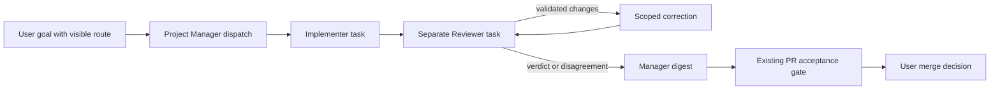

# CC2: faster delegation and fewer coordinator turns

CC2 is a source audit and an implementation design. It changes no application code. Source references describe `de8edc3b389c3362134cc5a521458b241496b4c2` on `HenkDz/cc2-orch-design`, before CC0, CC1 and CC4 integration. Recheck the references after those rounds merge.

The largest opportunity is to remove unnecessary coordinator model calls. The measured Grand Orchestrator routing turn used 22 calls and took 359.296 seconds; it emitted its assignment after 330.258 seconds. The receiving Manager started 8.244 seconds after the receipt. Accelerating local IPC alone cannot remove that routing delay. Reliable CLI output, role effort defaults, deterministic routing and wake batching come before provider prewarming.

Keep the existing authority boundaries: only user requests or approved habits create goals; reports and artifacts remain untrusted evidence; assignments retain project/member/file scope; an independent Reviewer owns separate dispatch evidence; PR acceptance remains a separate gate; the user alone merges and authorizes destructive actions. A performance change must preserve these boundaries.

## Evidence and measurement boundaries

The program baseline is `C:/Users/nooro/AppData/Local/Temp/monocode-cc/FINDINGS.md`. Raw extracts and original analysis scripts live in the sibling `evidence/` directory. CC2 evidence lives in `C:/Users/nooro/AppData/Local/Temp/monocode-cc/cc2/`:

- `handoff-evidence.md`: source trace, provider startup and CLI-output suspects.
- `rollout-evidence.md`: chronological rollout analysis and exact input/turn totals.
- `rollout-evidence.json`, `rollout-summary.json`, `rollout-detail.json`, `rollout-overhead.json`: bounded remeasurement and individual calls.
- `audit_rollouts.py`, `rollout_metrics.py`, `compact_rollout_evidence.py`, `view_rollout_detail.py`: read-only analysis helpers; five extraction assertions passed.
- `validation-evidence.md` and `validation/`: command logs, counts, exits and timings.

These are local evidence paths, not files committed by CC2. Original profile rollouts and the copied database were read only; no live model turn or preview was started. The original extraction scripts point to `C:/Users/nooro/AppData/Local/Temp/mcan`; its existing `db/monocode.db` was opened with SQLite `mode=ro` to match worker session IDs because the documented `monocode-cc/evidence/db` copy was absent. Graph discovery found no indexed MonoCode project, so the audit used narrow source searches. Source proves the control flow; it does not prove individual runtime span durations or the historical cause of empty stdout.

Use distinct latency endpoints:

| Metric | Start | End | Interpretation |
| --- | --- | --- | --- |
| Routing attempt delay | Grand `task_started` | Emitted outer tool wrapper containing `goals.assign` | Historical wrapper timestamp; input-file writing may precede actual CLI launch |
| Dispatch attempt delay | Manager `task_started` | First emitted wrapper containing `control delegate` | Includes uncertain/blank-output attempts; accepted receipt is a separate endpoint; cold setup reported separately |
| Wrapper-to-receipt latency | Assignment/delegate wrapper emission | Wrapper output containing parsed durable acceptance | Includes input preparation, command launch, app validation and persistence; multiple nested calls may share the receipt timestamp |
| Target-start latency | Receipt observed | Target rollout `task_started` | Historical rollout endpoint; includes queue/startup overhead |
| Provider-start latency | App accepts/queues target turn | `turn/start` acknowledgement | Requires app/provider spans; not equivalent to first token |
| Historical TTFT | Provider-reported turn start | Provider-reported first-token endpoint | Use rollout `time_to_first_token_ms`; may include compaction and scheduling |
| App time to first visible output | App accepts target turn | First visible assistant event | Requires CC4 spans; not the historical provider TTFT |
| Completion wake | Worker terminal event | Manager rollout `task_started` | Includes finalization, queue eligibility and parent startup |

Do not sum role medians to manufacture a per-hop measurement. Empty CLI output has no observed receipt timestamp: record an unknown outcome, then correlate its retained request ID to the app/target events. Do not count a silent command as rejected.

## One hop through the current code

The actual org path is a harness-native shell call to the injected executable: Grand uses `app goals.assign`; Manager uses `control delegate`. It is neither a provider-native `spawn_agent` nor the parsed orchestration-plan path. The current instruction is explicit at `src/features/monos/model/monoOrg.ts:199`.

### Grand Orchestrator to Manager

| Step | Source | Blocking and estimated cost |
| --- | --- | --- |
| 1. Model emits native CLI command; CLI mode runs before desktop initialization | `src-tauri/src/main.rs:7`; `src-tauri/src/control_cli.rs:907`; `src-tauri/src/control_cli.rs:931` | Model work precedes this hop. CLI process blocks for an app reply, not the Manager's completed turn. Process-launch cost is unmeasured, plausibly tenths of a second. |
| 2. CLI sends authenticated bounded JSON over local TCP | `src-tauri/src/control_cli.rs:1005`; `src-tauri/src/control_cli.rs:1043` | Synchronous request/response. The 40-second read timeout at line 1037 is a failure bound, not a normal delay. |
| 3. Native server validates action and active-turn grant, emits frontend request | `src-tauri/src/control.rs:311`; `src-tauri/src/control.rs:343`; `src-tauri/src/control.rs:363` | Bounded pending requests and server threads; waits for frontend response, capped at 35 seconds at line 367. Uncontended IPC should be small; saturation can block. |
| 4. Frontend resolves actor and goal action; ledger validates origin, project and role | `src/app/App.tsx:12088`; `src/app/App.tsx:12379`; `src/features/monos/model/monoManagerGoals.ts:327` | JS validation plus project resolution/hydration; serialized ledger access at line 153 can wait behind another request. |
| 5. Persist goal and receipt/outbox before delivery | `src/features/monos/model/monoManagerGoals.ts:378`; `src/features/monos/model/monoManagerGoals.ts:218` | Awaited durable save. Reusing the same request ID replays the receipt/outbox; changed arguments are rejected at line 274. Usually milliseconds to tenths of a second, storage contention unmeasured. |
| 6. Resolve direct Manager, load/create chat, register/hydrate engine, persist queued goal once | `src/app/App.tsx:11999`; `src/app/App.tsx:12022`; `src/app/App.tsx:12045`; `src/features/monos/model/monoWorkspace.ts:45` | Awaited session/engine persistence. A busy Manager can still accept queued delivery. Receipt is acceptance, not a started model. |
| 7. Return result through native reply to CLI | `src/app/App.tsx:12917`; `src-tauri/src/control.rs:642`; `src-tauri/src/control.rs:382`; `src-tauri/src/control_cli.rs:949` | Resolves the CLI caller. A print/capture fault after acceptance leaves an unknown observed result, not permission to redispatch. |
| 8. Queue scheduler selects idle head and submits | `src/app/App.tsx:9615`; `src/app/App.tsx:9766`; `src/features/sessions/model/messageQueue.ts:38`; `src/features/sessions/model/messageQueue.ts:53` | Scheduler timer is **0 ms**. Busy/paused/edited/quota/storage/worktree/handoff gates can wait indefinitely. `monoSource` cannot steer into a busy turn; user queue ordering stays intact. |
| 9. Prepare Codex storage, compose context/attachments and call provider | `src/app/App.tsx:7308`; `src/app/App.tsx:8535`; `src/app/App.tsx:8719`; `src/app/App.tsx:8618`; `src/app/App.tsx:8778` | Preparation is awaited. Local prompt assembly should be milliseconds; storage and cold provider work can take seconds. Details below. |
| 10. Registry serializes session operations; Codex starts turn | `src/integrations/harness/core/registry.ts:285`; `src/integrations/harness/core/registry.ts:319`; `src/integrations/harness/providers/codex/codex.ts:873`; `src/integrations/harness/providers/codex/codex.ts:883` | `turn/start` RPC acknowledgement precedes model output. Never label thread creation or request queuing as actual model inference. |

### Manager to worker

The CLI transport and native response steps above recur. The additional steps are:

| Step | Source | Blocking and estimated cost |
| --- | --- | --- |
| 1. Resolve Manager/project engine, enforce direct member/profile and existing goal authority | `src/app/App.tsx:12097`; `src/app/App.tsx:12120`; `src/app/App.tsx:12176`; `src/app/App.tsx:12215` | Awaited validation. Event-origin turns cannot manufacture fresh work. |
| 2. Deduplicate request, serialize mutation, validate task/model/scopes/dependencies, snapshot base, persist task | `src/features/orchestration/model/orchestration.ts:1464`; `src/features/orchestration/model/orchestration.ts:1661`; `src/features/orchestration/model/orchestration.ts:1817`; `src/features/orchestration/model/orchestration.ts:1845`; `src/features/orchestration/model/orchestration.ts:1901` | CLI waits for receipt; actions/persistence are serialized across runs. Native Git/base checks may cost hundreds of milliseconds or seconds. A new task already gets a fresh session ID at line 1869. |
| 3. Pump chooses eligible work and persists dispatch authority | `src/features/orchestration/model/orchestration.ts:2454`; `src/features/orchestration/model/orchestration.ts:2465`; `src/features/orchestration/model/orchestration.ts:2504` | Worker cap, overlapping files and unaccepted dependencies intentionally hold work. No fixed handoff sleep. |
| 4. Prepare worker checkout, permissions, scratch directory and task session | `src/features/orchestration/model/orchestration.ts:2541`; `src/app/App.tsx:11148`; `src/app/App.tsx:11174`; `src/app/App.tsx:11211`; `src/app/App.tsx:11274`; `src/app/App.tsx:11330` | Awaited worktree creation/restoration and persistence. Typically the largest worker-specific local cost. Preparation of eligible workers is serial through these awaits; one slow checkout can delay later workers. |
| 5. Snapshot/verify checkout, bind scopes, persist prepared dispatch | `src/features/orchestration/model/orchestration.ts:2545`; `src/features/orchestration/model/orchestration.ts:2565`; `src/features/orchestration/model/orchestration.ts:2591` | Safety checks block submission. Never drop inherited-change, scope or base validation to improve startup time. |
| 6. Build prompt; bridge managed submit and settlement | `src/features/orchestration/model/orchestration.ts:2604`; `src/features/orchestration/model/orchestration.ts:2613`; `src/features/orchestration/model/orchestration.ts:386`; `src/app/App.tsx:11511`; `src/app/App.tsx:8752` | App submission is asynchronous with a settlement callback. Dispatch `turn_submitted` at line 2624 describes app submission, not provider acknowledgement. Member soul/memory and review context are added before sending. |
| 7. Storage preflight and provider start | `src/app/App.tsx:7289`; `src/app/App.tsx:7308`; `src/app/App.tsx:8628`; `src/integrations/harness/providers/codex/codex.ts:873` | Worker owner lookup can trigger storage preflight. However, a task session may lack `codexStore:"mono"` at sendTurn, so do not charge every worker the additional temporary config-reader process. |

The separate user-selected orchestration proposal calls `completeOrRepairOrchestrationProposal` at `src/app/App.tsx:8788`. `src/features/orchestration/model/orchestrationPlan.ts:311` permits one parser-repair model turn; approved-plan startup is at `src/features/orchestration/model/orchestration.ts:1152`. This can add planning/repair latency, but it does not explain the observed org Manager CLI dispatches.

### Worker completion to Manager wake

| Step | Source | Blocking and estimated cost |
| --- | --- | --- |
| 1. Provider receives terminal notification and resolves active turn | `src/integrations/harness/providers/codex/codexProtocol.ts:605`; `src/integrations/harness/providers/codex/codex.ts:1027`; `src/integrations/harness/providers/codex/codex.ts:1367` | Waits for provider terminal notification. A tool/report alone is not a terminal event. |
| 2. App finalizes checkpoints and calls settlement | `src/app/App.tsx:8855`; `src/app/App.tsx:8977` | Awaited writer/checkpoint finalization. Persistence cost is unmeasured; retain it. |
| 3. Engine validates outstanding writes/read-only snapshot, commits terminal dispatch and undelivered result | `src/features/orchestration/model/orchestration.ts:2650`; `src/features/orchestration/model/orchestration.ts:2666`; `src/features/orchestration/model/orchestration.ts:2695`; `src/features/orchestration/model/orchestration.ts:2730` | Serialized safety/persistence can block. Completed means ready for inspection, not accepted. |
| 4. Sync detects any result/blocker and waits for Manager eligibility | `src/features/orchestration/model/orchestration.ts:3037`; `src/features/orchestration/model/orchestration.ts:3048`; `src/features/orchestration/model/orchestration.ts:3055`; `src/features/orchestration/model/orchestration.ts:3202` | Timer is **0 ms**. Batches coincident results only; does not wait for all dispatched workers. Busy/quota/storage/user-queue gates can wait indefinitely. |
| 5. Persist delivery, recheck user race, construct digest and submit | `src/features/orchestration/model/orchestration.ts:3094`; `src/features/orchestration/model/orchestration.ts:3104`; `src/features/orchestration/model/orchestration.ts:3132`; `src/features/orchestration/model/orchestration.ts:3161` | Delivery is rolled back if user input wins or quota/storage prevents continuation. Max 20 automatic continuations at line 3085. Preserve these protections. |
| 6. Owner bridge reaches Manager chat, then storage/provider start | `src/features/orchestration/model/orchestration.ts:386`; `src/app/App.tsx:11511`; `src/integrations/harness/core/registry.ts:206`; `src/integrations/harness/providers/codex/codex.ts:873` | Existing three-minute idle parking often makes the parent cold after a ten-minute worker task. Parent model output is later than its start RPC. |

Team messages are a second path: `src/features/monos/model/monoCrewEvents.ts:13` defaults `requiresReply` to true; `src/app/App.tsx:12256` directly steers/submits recipients and bypasses engine batching. Explicit false already records a feed item without waking. Generic `sessions.start` completion batching in `src/features/monos/model/monoSessionCompletion.ts:139` is another mechanism and does not cover the engine's worker tasks.

### Cold provider path and cost reconciliation

`src/integrations/harness/providers/codex/codex.ts:512` reuses only a matching live process. A cold private Mono session resolves the binary and prepares context at line 570; `src/integrations/harness/providers/codex/codexStore.ts:116` starts a temporary app-server for initialization/config reading and possible retained-thread preparation. The actual Codex process starts at `codex.ts:665`, initializes at line 679, then resumes/starts a thread at lines 706/745. Native spawn uses `src/integrations/harness/core/child.ts:344` and `src-tauri/src/harness.rs:926`; private storage preparation runs at line 948, with file preparation serialized by `src-tauri/src/codex_mono_store.rs:245`. Effort is applied at `codex.ts:838`/848 during turn start, not thread creation.

Estimated uncontended JS work is milliseconds, native command/IPC/persistence tenths of a second, and worktree/storage/provider initialization hundreds of milliseconds to several seconds per stage. These are hypotheses, not measured additive budgets. Cold starts and recipient model scheduling plausibly explain the measured 10/11/8-second medians; queued work, storage failures or compaction can make them much longer. The exact Grand receipt-to-Manager sample below supports the overall baseline. There is no built-in eight-second timer to remove.

Instrument request received, receipt persisted, target queued, storage prepared, checkout prepared, process spawned, initialized, thread bound, turn submitted/acknowledged, first output and settled. Correlate request/goal/task/dispatch/session IDs; retain durations, outcomes and effort, never credentials or prompt bodies. Existing dispatch stages are useful but insufficient. Coordinate this schema with CC4 instead of building a second metrics system.

## Why routing consumed 22 model calls

The routing turn is Grand rollout `01a125c8-cb28-7a53-9a39-c1630d95a109`, 2026-10-10 15:12:34.769–15:18:34.065 UTC, JSONL lines 115–296. It contains 22 usage records, 20 `functions.exec` wrappers, 1,534,067 input tokens and 1,455,104 cached input tokens, at xhigh effort; no compaction occurred in this turn. The request was to make two PRs merge ready, with the explicit clarification that they belong to dzdistro (lines 117/121).

| Observed stage | What happened | Why it matters |
| --- | --- | --- |
| Discover/recover application calls | Repeated `projects.list` through plain PowerShell, inline JSON, TTY, file input and redirected output returned empty output with exit 0. Bash executable lookup failed; a quoted cmd invocation failed; an unquoted cmd form finally returned output at 15:17:12.411. | Empty success output made acceptance/data uncertain and caused shell/output verification calls. The existing direct-command guidance did not reliably prevent shell experimentation. |
| Context and scope checking during recovery | Grand read skills/memory, inspected the executable and repository remote, queried both PRs with `gh`, and examined MonoCode CLI source/graph while resolving the output problem. | Some scope checking was useful; repository/CLI investigation repeated work that a correctly returned project snapshot and receipt could avoid. It expanded a routing decision into debugging. |
| Assignment | Outer wrapper containing input-file writing and `goals.assign` emitted at 15:18:05.027, line 276; receipt output at 15:18:07.562, line 280. | 330.258 seconds before emitted assignment wrapper; 2.535 seconds wrapper-to-receipt, not exact native CLI launch-to-receipt. |
| Receiver and closure | dzdistro Manager `task_started` at 15:18:15.806; Grand then closed with dispatch/card reporting. | 8.244 seconds receipt-to-target, 10.779 seconds invocation-to-target. These are different endpoints. |

The wrappers account for 31.292 seconds of the 359.296-second turn. About 328 seconds are outside those wrappers; predominantly model/runtime work is a reasonable inference, not a measured server-only reasoning duration. This is not evidence that 22 routing decisions were necessary, or that xhigh alone caused all the delay. The complete sequence is:

| Model call / usage line | Observable action |
| --- | --- |
| 1 / 123 | Initial one-output-token record, no tool wrapper |
| 2 / 130 | Read RTK/project memory; try injected `app --help` |
| 3 / 139 | PowerShell `projects.list`: empty output, exit 0 |
| 4 / 146 | Retry list with inline JSON: empty, exit 0 |
| 5 / 155 | Read Windows-operations skill; TTY list retry |
| 6 / 164 | Write input file; list with `--input`: empty, exit 0 |
| 7 / 171 | Try executable through Git Bash |
| 8 / 177 | Poll Bash result: executable path not found, exit 127 |
| 9 / 188 | Redirect/read list output: still empty |
| 10 / 196 | Check executable exists, repository remote and tool capabilities |
| 11 / 204 | Read both PR snapshots; start CLI source search |
| 12 / 213 | Retry search with explicit patterns |
| 13 / 222 | Try guessed Rust CLI source path: missing file |
| 14 / 229 | Find actual CLI/console source symbols |
| 15 / 236 | Read startup/process-exit implementation |
| 16 / 244 | Try graph discovery: MonoCode not indexed |
| 17 / 250 | Read actual CLI-mode dispatch implementation |
| 18 / 259 | Quoted executable through cmd: quoting failure |
| 19 / 266 | Unquoted cmd list returns project JSON |
| 20 / 278 | Prepare two-PR brief/input; assign goal and receive acceptance |
| 21 / 285 | Submit delegated-goal chat card |
| 22 / 294 | Final assignment acknowledgement |

`evidence/go_t2.txt` is a different turn: it matches this Grand rollout line 304 at 19:09:22.514 UTC, a completion/reactive turn. The filename must not be treated as the 22-call routing turn. It contains the org chart, worker/review/authority rules and repeated application context; `src/app/App.tsx:8720`, `src/features/monos/model/monoOrg.ts:189` and `src/features/monos/model/monoFiles.ts:343` show their current producers. CC1 owns prompt deduplication/budgets; CC6 owns global skill/plugin injection. This design does not duplicate those fixes.

### Managers before first dispatch

| Sample | Work before dispatch | Exact timing |
| --- | --- | --- |
| dzdistro Manager | Six pre-dispatch tool batches read control help/team/worktrees/protocol, both PR snapshots and retained checkouts, branch history/readiness/overlap, existing sessions and prior conversations, followed by composing two detailed worker briefs. Two delegate commands shared one wrapper. | Start 15:18:15.806; first delegate wrapper 15:22:25.825: **250.019 s / 4.17 min**. First worker starts 15:22:45.989: 20.164 s after wrapper start, including sequential commands; not a clean single receipt-to-worker hop. |
| browser-link-4 Manager, TinyJS goal | Repository/context/tool checks and assignment drafting, then silent delegate attempts and a TTY retry. The worker started despite the missing observed receipt. | Start 20:36:34.709; first attempts 20:38:56.832: **142.123 s / 2.37 min**. TTY retry 20:39:12.098: **157.389 s / 2.62 min**. Worker starts 20:39:18.370. The baseline's 2.6 min corresponds to the retry, not the first attempt. |

The entire respective Manager turns contained 21.611/19.094 seconds inside recorded wrappers over 271.898/211.175 seconds total. Tool time alone is not the dominant delay. In dzdistro, the final prior tool batch returned at 15:20:53.362; 92.463 seconds elapsed before the delegation wrapper, whose generated output included 3,080 output tokens (516 reasoning). Long brief drafting contributes; that interval is not all reasoning. Current Manager guidance explicitly asks for project study, `team.list`, `models.list`, purposeful hiring and souls/memory before first worker-requiring goals (`monoOrg.ts:197`). Preserve first-project study, but retain its scoped project-study artifact and team rationale; do not require rediscovery on every warm assignment. Put a compact cached roster/project/goal snapshot in the dispatch turn. A Manager with an established team should resolve ownership, write a bounded brief, dispatch, then finish launch/reporting work.

Raw source index: the shared profile root is `C:/Users/nooro/AppData/Roaming/com.monocode.desktop/codex-monos/default/sessions/2026/10/10/`. Grand is `rollout-2026-10-10T13-27-58-01a125c8-cb28-7a53-9a39-c1630d95a109.jsonl` (115–296, prompt dump 304); dzdistro is `rollout-2026-10-10T14-35-42-01a12606-cdde-75a1-845a-d3fb90dfa7fc.jsonl` (176–270, dispatch 256, receipts 262); TinyJS is `rollout-2026-10-10T13-06-03-01a125b4-b7aa-7c93-9976-ea7d796bccc5.jsonl` (670–779, attempts 731–736, retry 749–752). Worker roots are `C:/Users/nooro/AppData/Roaming/orca/codex-accounts/88ba8c3a-ed48-4db9-96ba-b4ed1f3d1688/home/sessions/2026/10/10/`: Lina `rollout-2026-10-10T16-22-44-01a12668-cbc2-7732-9920-d8141bc943cc.jsonl:2`; Native `rollout-2026-10-10T21-39-17-01a1278a-986d-7732-984a-fa431a4ec879.jsonl:2`. The compact JSON and evidence note index all other cited samples.

### Reaction, review and compaction evidence

CC2 remeasurement reproduces 54 Manager turns / 508 calls / 76,890,165 input tokens, and 29 worker turns / 857 calls / 106,959,849 input tokens. Of the Manager turns, 25 begin with worker reports and 12 with worker team messages: 37/54 are worker-triggered reactions. Another three team-message turns originate from Grand. There are 104 worker `team.message` wrappers; a wrapper is not necessarily one successfully delivered message.

The full report-reaction subset has median 171.146 seconds and 1,201,995 input tokens; the worker-message subset has median 99.334 seconds and 761,269.5 input tokens. FINDINGS' 47–108 seconds / 0.3–0.8M describes selected reactions, not those complete distributions. Input is mostly cached; reducing calls and elapsed time still matters, but these totals are not an uncached-billing estimate.

The matched 23 rollouts contain 12 compaction records (Grand 1, Managers 5, workers 6), versus the program baseline's 13. Seven turns with provider-reported TTFT above 60 seconds span 77.529–195.657 seconds and all have a compaction record before first response. The scope/count discrepancy remains explicit. Correlation does not assign every millisecond of delay to compaction. One review lasts 776.495 seconds (15:53:41.698–16:06:38.072) before requesting changes; another review's completion-to-Manager-start is 7.822 seconds. The two-PR assignment through final Manager turn spans 3 h 58 min 10.486 s with CC2's specified endpoints, whereas FINDINGS uses an unspecified nearby endpoint for 3 h 57 min. Long implementation/review/fix cycles and the 43-minute / 97-call worker maximum make bounded work and fewer reaction turns more valuable than shaving another millisecond from handoff.

## Proposed mechanisms

All names marked **new** below are proposed modules/fields, not implemented by CC2. Use the current stores, adapters, model controls, task/worktree engine and artifacts; add no dependency or separate scheduler service.

### 1. Reasoning effort defaults by role

Default Grand and Managers to **medium** and workers, including Reviewers, to **high**. Low remains an available user choice and an experiment for simple coordinators; do not automatically lower effort on ambiguous/cross-project decisions. Use `modelEffortSetting`/`mergeModelSettings` from `src/features/sessions/model/models.ts:523` and line 554 to use each provider's actual setting ID and advertised values. If medium/high is unsupported, keep the provider default and display the effective value; never silently change model/provider.

Precedence is user-locked/explicit choice, retained legacy choice, role default, provider default. `preferredModelSettings` at `models.ts:576` overlays the globally remembered setting, and `newSession` at `src/features/sessions/model/session.ts:589` uses it; ordinary chat's last high/xhigh selection must not overwrite a newly resolved role default. Resolve org settings after generic creation with `mergeModelSettings`, at Mono first-open (`monoWorkspace.ts:86`) and worker preparation (`App.tsx:11282`). A prepared task snapshots its effective profile; later edits do not mutate an active task.

**Data and ownership.** Add optional `effortSource:"role"|"user"` to Mono in the shared schema integration. Existing populated profiles/sessions without metadata stay explicit/legacy; do not migrate their high/xhigh choices silently. New role sessions record role source; UI selection records user source. Reuse `workerProfile.modelSettings` and `userLockedFields` (`src/features/monos/model/mono.ts:49`); extend the currently member-only `lockMonoField` at `monoTeam.ts:310` narrowly for coordinator model settings. **New** `monoRoleEffort.ts` resolves effective settings without writing global preferences. Integrator wires first-open and worker preparation; existing member setting edits already lock at `src/features/monos/ui/MonoTeamPage.tsx:264`.

**UX.** Reuse `ModelSettingRows` in `MonoDetails.tsx:323`/`MonoTeamPage.tsx:264`, showing effective effort and `Role default` or `Set by you`. Add a clear reset-to-role-default action that clears only the effort choice/appropriate lock after the user's click. Show effort in the worker task details supplied to CC3/CC4. No extra confirmation for a reversible setting edit.

**Risks/tests.** Cover global-last-xhigh leakage, unsupported providers, locked model settings, explicit unlocked choices, retained legacy high, model/account switches, reopened/reset conversations and worker retries. Compare equivalent synthetic routing workloads at medium/high, recording correctness and effort along with calls/latency; a smaller setting is not proof of faster successful routing.

### 2. Deterministic project routing

Intercept a **user-origin new-goal submission**, before starting a Grand model turn. A selected registered project chip or exact registered project identity maps to its one active Manager. Exact unique project names/paths in free text can preselect the visible chip; zero/multiple matches, comparison/cross-project requests, unavailable/archived Managers and a user-selected Grand route fall back to Grand. No fuzzy embedding/classifier/model call. Ordinary chat questions keep chat behavior; goal mode identifies work explicitly instead of guessing whether prose creates a task. Unsupported attachments or an oversized goal use the existing full submission path until the goal ledger supports them, preserving content.

The composer shows `Send to <project> Manager` and the matching reason before Send, with a Grand/Manager override. Send authorizes that displayed route without a second approval. Revalidate canonical project identity, active roster and registration immediately before persistence; reuse `projectKey`/`pathKey`, `validManagerProjects` and existing engine ownership rather than display names. Never route a report, team message, tool output, PR body or unapproved habit as a new goal.

**Data and ownership.** **New** `monoGoalRouting.ts` returns a pure routing decision and handles the UI-origin submission adapter. Keep goals in `MonoManagerGoals`: invoke the existing `handle` with the Grand owner ID, a durable user-message origin and one stable request ID; the Grand need not have an active model turn. Do not fake an active CLI grant or broaden `mayDelegate` (`src/app/App.tsx:11884`). Add optional route metadata to the goal (`monoManagerGoals.ts:31`): source user-message ID, selected project/Manager, match reason and route override. Retain outbox-first delivery at line 378. Store the original request/route card once even if delivery is temporarily blocked.

**UX and wiring.** A small adapter at the shared submit boundary (`App.tsx:7282`/8999), also used by floating Mono submission at line 14450, ensures both surfaces behave identically. A **new** `MonoGoalRoute.tsx` uses existing composer/card styling. Record route acceptance and expose the queued/blocked Manager honestly. Override before Send; after dispatch, moving work is an explicit user cancellation/reassignment that retains old tasks/checkouts and references the original goal. It must not silently duplicate execution.

**Risks/tests.** Exact matching with overlapping names, Windows case/path normalization, nested repositories, two project mentions, archived/remote/unregistered targets, stale roster, busy target, repeated Send/reload, no Grand session yet, explicit Grand override, ordinary questions, attachments/8K limit and denied event-origin assignment. Test one goal/receipt on retries and visible route metadata. Eligible goals must produce **zero Grand model calls** and reach the same project/authority boundary as manual `goals.assign`.

### 3. Manager wake batching and message digests

Use an engine-owned, durable **dispatch wave** identified by Manager owner session and originating turn/request. Seal it when the delegator turn settles so a fast first child cannot wake before the remaining siblings are accepted. A wave covers actually dispatched work for that launch stage; it does not wait for every queued future dependency in a goal. Persist outcomes as they arrive, and keep individual reports visible without starting a Manager turn.

Wake only for: all dispatched logical work in a sealed wave finished; an explicit decision/escalation; a failure; or a persisted timeout. A review fork counts as one logical work unit until verdict. A successful prerequisite that cannot unlock queued work without Manager acceptance is a **decision/gate** event, avoiding deadlock before review-fork automation exists. Pause/cancel retires the wave and emits appropriate visible state without manufacturing extra goals. New user messages keep precedence and may start their own turn.

**Data and ownership.** **New** `managerWake.ts` owns a pure reducer/digest builder. Optional `wakeState` on `OrchestrationRun` stores wave IDs, accepted dispatch IDs, closed/deadline state and pending event IDs/delivery receipts. Events carry kind, goal/task/dispatch/request identity, timestamp, short text/artifact reference and whether action is required. Use `control_save`/existing run persistence, not the 500-entry crew feed as the authoritative outbox. Unknown legacy runs retain current delivery behavior until their next explicitly created wave. Deduplicate terminal and team-message events by stable IDs; do not infer success from the sender's prose.

Integrator replaces the eligibility decision in `orchestration.ts:3037` and routes Manager-bound messages at `App.tsx:12256` through the same outbox. Reuse the existing queue/user-race/storage retry safeguards. Advance a digest receipt only after durable target acceptance; unknown acceptance keeps the same request ID and pending evidence. Never silently evict unacknowledged events to fit a capacity limit.

**Message policy.** Preserve existing `requiresReply:false`. Add validated `kind:info|question|decision|escalation` for new callers. Explicit kinds guide scheduling; legacy omitted `requiresReply` still means action required, preserving compatibility. New prompts/examples explicitly label progress/acks/info with false. Manager-bound legacy questions form one pending action digest; direct questions to a live worker can retain steering, and cross-team routing still uses `teamMessageRoute` (`monoOrg.ts:48`). Do not classify natural language to suppress a possible real question. A tiny bounded coalescing window (250 ms for independent messages) merges near-simultaneous questions; failure/escalation/approval alerts have no deliberate delay. Routine messages wait for a permitted wake trigger.

**Timeout/UX.** Persist one 15-minute wave deadline, measured from the last accepted child in the closed wave. On expiry send one timeout digest with still-running tasks; do not cancel tools or wake every 15 minutes. A Manager/user follow-up can create a new bounded stage. Restore deadlines after restart; storage/quota blocks retain overdue events. CC3/CC4 show `Waiting for 2 workers · 3 updates held`, immediate failures/decisions and a readable digest with links to full reports. Holding a report must not make a blocked worker look idle.

**Risks/tests.** Fake-clock tests for early completion before wave seal, four staggered workers, 20 info messages, multiple question coalescing, immediate failure/escalation, one timeout, reload replay, changed request arguments, user-send race, quota/storage failure and lost receipt. Cover dependency acceptance, multiple projects/turns, cancellation, pending approvals and legacy runs. Happy path: one completion wake for four workers, zero turns for info-only messages, no lost action-required event. Reduce worker-triggered Manager turns from the 37-turn matched workload with equivalent work; do not claim a reduction by dropping failures/questions.

### 4. App-managed implementer/Reviewer fork

Once the Manager delegates a bounded implementation with an active Reviewer, the app runs `implementation -> separate review -> scoped correction -> new separate review`. Worker peers can discuss findings directly; only app state/validated review artifacts advance steps. A chat message saying `approved` cannot advance the fork. The Manager wakes for a final verdict, a scope/authority decision, failure or disagreement, rather than every transition.

Reuse `reviewOf`, exact dispatch IDs, artifacts and checkout identity from `orchestrationState.ts:92`, `recordReviewerResult` (`orchestration.ts:475`) and `approvedMemberReview` (`src/features/orchestration/model/memberReview.ts:4`). The engine already attaches correction handoff evidence at `orchestration.ts:538`/561, and auto-queues re-review for a moved PR head at line 2423; extend this behavior rather than creating an independent review runner. Review always reads the exact implementation checkout/commit with enforced read-only mode or isolated fallback. Freeze the reviewed target until review settles; compare base/HEAD/fingerprint again before accepting a verdict.

**Data and ownership.** **New** `reviewFork.ts` is a pure step planner. Optional fork records on the run bind implementation task/dispatch/head, Reviewer task/dispatch, phase, correction count and pending transition receipt. Phases are reviewing, correcting, verdict and disagreement; current task/dispatch state remains authoritative. Plan/persist the next step once before spawning. Reuse the implementer's retained checkout for corrections; every correction has a new dispatch ID, every review a separate task/session. At most two automatic correction cycles; a rejected finding, scope change, competing writer, missing Reviewer, unavailable permissions or exhausted limit emits a Manager decision. No harness switch to bypass a refusal.

**UX/gates.** Task card shows the current step, commit, Reviewer, findings and correction count; expanded timeline links both agents. A final approval wakes the Manager with evidence; it does **not** call `control review`, publish/push, merge or remove a checkout. Keep artifact requirements and the independently revalidated open non-draft PR/base/current-head checks at `orchestration.ts:2111` and `src/features/orchestration/model/projectManager.ts:11`. Existing trivial/no-change flows remain explicit. Same-model review is allowed; independent means a different Reviewer identity and dispatch, enforced at `orchestration.ts:517`.

**Risks/tests.** Separate-member enforcement; missing/wrong-scope artifact; stale implementation/review dispatch; changed commit during review; concurrent duplicate verdict; restarts in every phase; correction stays in original files/worktree; read-only violations; cancellation/retirement; two-cycle limit; disagreement; final approval wakes once and leaves PR gate closed until Manager acceptance. Add integration tests with current `maintainDelivery` so stale PR re-review does not create duplicate Reviewer tasks. PR-gate tests must still reject missing/stale review and draft/wrong-base PRs; human merge remains outside the fork.

### 5. Bounded worker turns and earlier rotation

New delegate tasks already create fresh session IDs (`orchestration.ts:1869`); do not build that feature twice. Preserve retained checkout/session recovery for interrupted work and corrections. Give a task one coherent module/change, explicit file ownership, one acceptance result and roughly 5–15 minutes of expected agent work. Split discovery, implementation and integrated verification into dependent stages when each is substantial. Parallel scans can be read-only. Do not split a safety-critical transaction merely to hit a duration target or dispatch overlapping editors.

Have the worker checkpoint/report at a stage boundary before starting a second broad investigation. Store full evidence in scoped artifacts and return a short conclusion plus links. Reuse bounded `memberContinuity` (`src/features/orchestration/model/memberContinuity.ts:4`); avoid carrying complete implementation transcripts into reviews. First-project study is a reusable project-study artifact, not repeated Manager exploration. These prompt changes must integrate with CC1's prompt budget and CC6's skill scope.

**Rotation/data.** Current Mono rotation triggers only before a new turn at 80% of reported window (`src/features/monos/model/monoRotation.ts:15`/50; `App.tsx:7974`). It cannot prevent a 43-minute single worker turn from compacting internally. **New** `taskContextBudget.ts` calculates between-turn eligibility: when a provider exposes its effective compaction threshold, rotate before projected context reaches 75% of that threshold; otherwise use 60% of a known window as a conservative heuristic. `ContextUsage` (`src/features/sessions/model/contextUsage.ts:9`) gains an optional effective threshold only when advertised/read from the selected provider configuration; never invent a model threshold. Unknown window/threshold remains unknown. Use conservative bounded input growth for projection, not billed/cumulative tokens. Worker task segmentation is the primary safeguard when no safe between-turn boundary exists.

Integrator applies the policy to org chat and idle task continuation, retaining app session/task/checkout IDs but replacing provider thread identity. Reuse the existing deterministic rotation brief, add scoped goal/dispatch/artifact references, preserve original user constraints and unsettled approval/question state, and do not rotate while a turn/tool/permission decision is live. Full saved transcript remains accessible. Never clear user data or call the destructive chat reset to achieve rotation. A new task's fresh session is already sufficient; reuse rotation only for long retained continuations.

**UX/tests.** Existing context meter shows actual provider readings; label scheduled rotation and unknown threshold plainly. Test exact boundary, unknown/stale model window, safe idle boundary, no rotation during tools/approvals, same scope/account after rotation, retained transcripts, user-locked profile and failed thread resume. Measure compactions per 100 turns and first-output p95 on equal work; compare at least 30 representative task turns. Targets are worker-turn p95 under 15 minutes and at least 50% fewer compactions; long tools/indivisible work are reported separately rather than force-stopped or hidden.

### 6. Prewarm only an accepted imminent target

Begin eligible target preparation after an assignment/dispatch is durably accepted, while other required work is still pending. The current engine already submits workers independently of the delegator's completion (`orchestration.ts:1518`/2613), and an idle Manager's queued goal already auto-submits (`App.tsx:9675`); the recorded Manager starts before Grand's final reply. Calling prepare immediately before that existing send has zero preparation lead and does not save the same cold work twice.

Useful lead comes from independent stages: accepted-task source/config/context loading alongside validated checkout/snapshot work, a recipient already waiting behind user input, or later accepted disjoint workers whose preparation currently serializes. Storage/config preparation can begin with a validated source/account; process/thread preparation waits for a validated effective checkout and inactive connection. For Grand->Manager, start after persisted delivery only if a real queue/preparation lead exists; otherwise send immediately. For Manager->worker, hook after persisted dispatch authority, preserving all submission checks. Do not delay an eligible send to manufacture a warm case, predict all possible recipients or create speculative worktrees. Overlap bounded independent I/O only when its scope/account/source are stable and revalidate before submission.

**Ownership/mechanism.** **New** `sessionPrewarm.ts` plus optional registry/adapter `prepareSession` capability calls Codex `ensureLive` without `runTurn`. Warm storage, app-server initialization and thread start/resume; load/render/hash local soul/memory/org context. Thread creation does not send a model prompt, so this warms local context assembly, not model KV cache. No seed model turn, no `turn/start`, no active-turn control grant. Actual submission still authorizes its real turn at `registry.ts:285` and assembles current context before send.

Native connection setup must be split before enabling that API. A fresh worker is attached without an app grant (`src-tauri/src/control.rs:494`); the current `control_authorize_turn` prepares a grant at line 562 and marks the turn active at line 575. Child environment injection at line 626 requires an existing app grant. Prewarming the process first would otherwise omit its CLI token; subsequent `ensureLive` reuse cannot repair the inherited environment. Add **inactive connection preparation** that validates attached session, owner window and checkout and prepares the scoped connection before spawn without inserting an active turn. The actual send alone activates the turn. The warmed process must both fail app CLI authorization while idle and succeed for its scoped supported actions after real authorization, without respawning. Do not grant a turn early as a workaround.

Share the existing per-session operation queue/single-flight with send. Key by session/provider generation, effective cwd, account, permission/read-only/ephemeral/store tuple and applicable model/thread settings. Refresh source/profile/context hashes immediately before send. Source/account/model/permission/checkout changes, retirement or cancellation invalidate the prepared target. Reuse `ensureLive` matching at `codex.ts:512`; do not bypass private storage serialization/CC0 repair. Failed prewarm retains the original blocker and goal; it must not mark readiness or synthesize completion.

**Data/UX.** Transient promise/generation state and CC4 timings are enough; no durable warm-process table. At most two imminent preparation operations, reusing the existing three-minute idle parking (`registry.ts:126`/206); stop/park unused owned processes. Never prewarm the whole roster, because each process/MCP set consumes real memory. Show `Preparing` separately from `Working`, with cancellation and storage error state. Provider-specific support is optional; unsupported adapters fall back to current cold submission.

**Risks/tests.** Assert zero model turns/usage during preparation; exactly one process/thread for concurrent prepare/send; stale settings spawn the correct isolated target; idle CLI denial followed by working scoped CLI in the same warmed process after actual authorization; unauthorized window/checkout cannot prepare the connection; cancellation has no fake completion; failed storage keeps retry outbox; source switch invalidates; context marked handed only after accepted real send (`monoFiles.ts:275`). Measure preparation lead, overlapped spans and critical-path time saved over at least 30 genuinely prepared cases, partitioning busy waits and immediate zero-lead dispatches. Target at least 50% lower remaining cold provider-start cost in that prepared cohort with no warm/zero-lead path regression beyond 10%, and unchanged completed-task correctness. Overall handoff improvement remains experimental; it depends on how often useful lead exists and does not remove Manager thinking time.

### 7. Reliable nonempty CLI responses

Current `src-tauri/src/control_cli.rs:931`–968 prints a JSON response and returns nonzero for errors; lines 1051/1058 read/parse the TCP reply (1043 writes the request). An empty wire response should therefore become an error, not silent success. `main.rs:1` uses the Windows GUI subsystem in release and lines 7–8 exit the CLI process; stdout printing has no explicit checked flush. These are **suspects**, not a proven explanation. Shell launch/wait behavior, inherited handles, quoting and provider capture also need localization. Existing CLI tests at `control_cli.rs:1388` primarily cover grammar/in-process/debug behavior, not packaged GUI-subsystem stdout across harness shells.

**Mechanism/ownership.** First build a synthetic endpoint test matrix using the actual release CLI: direct invocation, pipe/redirection and spaced executable path, supported modern PowerShell/cmd/Bash capture, `--input` and valid modern-shell `--json`, parse/auth/server errors and help. Check exactly one parseable JSON line for an action, meaningful nonzero error exit, complete output before process exit and one retained request ID. Do not treat unsupported PowerShell 5.1 inline JSON as valid syntax; retain its documented input-file alternative. Test all response branches, including large bounded responses and broken stdout pipes.

Fix the smallest proven layer: consolidate checked stdout write/flush in `control_cli.rs` and propagate write failure as nonzero; if inherited handles or GUI process launch is the cause, repair CLI-mode handle/wait/capture behavior only. If a console client is required, demonstrate that need before adding a second binary. Normal desktop launch must not allocate a visible console. Change provider shell mapping only if the native process produced valid bytes and the harness dropped them. Reuse the existing `ok/result/error` response shape; add response correlation/delivery metadata only compatibly, not another transport or client framework.

**Unknown outcome/UX.** A blank/capture failure after mutation keeps the request ID. Retry the same ID through the existing receipt store; never change ID/arguments and duplicate work. Show `Accepted/Queued` versus `Running`; a CLI receipt confirms delivery only. Failure output explains the exact error without credentials. A test accepts a goal, deliberately loses its first stdout, then retries and asserts one goal, one queued delivery and a returned receipt. In live accepted samples, a valid receipt should remove the need for another model call merely to verify that routing happened.

## Implementation rounds and conflict-free ownership

The coordinator can turn these **CC5 subrounds** into briefs; CC6 remains the board's separate skills/plugin round. Ranking is a qualitative impact/effort estimate (small=1, medium=2, large=3), not a measured ROI or promised speedup. Native stdout proof and role policy are inexpensive prerequisites; review automation is valuable but needs batching and exact-state recovery.

| Priority / round | Impact / effort | Exclusive parallel module ownership | Dependencies | Acceptance |
| --- | --- | --- | --- | --- |
| 1. CC5-A CLI response proof/fix | 3 / 1 | `src-tauri/src/control_cli.rs`, `main.rs`, new release CLI fixture scripts/tests; provider capture changes deferred to integrator if proved necessary | Current source; reconcile CC0 native changes | Zero blank successful responses across release shell matrix; same-ID lost-output replay causes one mutation; all native focused tests pass. |
| 2. CC5-B role effort and dispatch discipline | 3 / 1 | New `monoRoleEffort.ts` + tests; `MonoDetails.tsx`, `MonoTeamPage.tsx` effort UI; new prompt-policy module rather than editing `monoOrg.ts` concurrently | CC1 prompt contract; shared schema/adapters via CC5-I | New roles resolve medium/medium/high, explicit/locked/legacy selections unchanged; no global-setting leakage. Established-team first valid dispatch p50 <=60 s / p95 <=90 s over >=30 equivalent goals; cold team setup separate. |
| 3. CC5-C deterministic routing | 5 / 2 | New `monoGoalRouting.ts` + tests, `MonoGoalRoute.tsx` + tests; routing UI contract for embedded/floating composer | CC1/CC4 context/state; A reliable receipts; goal ledger changes via I | Zero Grand calls on 100 unambiguous text-only scoped goal fixtures; all ambiguous/unauthorized cases fall back/reject correctly; exactly one durable goal on retry. Receipt-to-target p50 <=10 s excluding busy/resource waits. |
| 4. CC5-D durable wake digests | 5 / 3 | New `managerWake.ts` + tests; `monoCrewEvents.ts` + tests and message-kind contract | CC4 event/timing schema; schema + engine/App integration via I | Four staggered reports +20 info messages yield one completion wake; failures/escalations surface immediately; no lost questions/replay duplicates; exactly one timeout. Equivalent 37-reaction workload target <=12 worker-triggered Manager turns. |
| 5. CC5-E bounded tasks/context rotation | 3 / 2 | New `taskContextBudget.ts` + tests; `monoRotation.ts` + tests, `memberContinuity.ts` + tests; prompt-policy contribution through B's owner | CC1 budget; CC6 separately improves skill context; schema/provider usage via I | Fresh task-session invariant remains; between-turn threshold cases pass; >=50% fewer compactions per100 equal-work turns and worker-turn p95 <15 min over >=30 cases, exceptions reported. |
| 6. CC5-F review fork | 4 / 3 | New `reviewFork.ts` + tests; `memberReview.ts` + tests; new review timeline component | D wave/event contract, E task boundaries; engine/schema/PR integration via I | Two correction cycles run without intermediary Manager turns; Manager receives verdict/disagreement once; stale/self/wrong-artifact review rejected; PR acceptance gate and human merge boundary unchanged. |
| 7. CC5-G target preparation | 1 / 3 | New `sessionPrewarm.ts` + tests; preparation planner; adapter implementation belongs to I | A response proof, CC0 storage behavior, CC4 spans, I submission interfaces | Zero preparation model calls; same-process idle-denial/active-access and single-flight tests pass; >=50% lower remaining cold cost in >=30 cases with measured lead; <=10% warm/zero-lead regression; report overall critical-path savings separately. |

**CC5-I is the single integration owner**, not an eighth parallel editor. It alone edits `src/app/App.tsx`, `src/features/orchestration/model/orchestration.ts`, `orchestrationState.ts`, `mono.ts`, `monoWorkspace.ts`, `monoManagerGoals.ts`, `monoTeam.ts`, `monoOrg.ts`, `monoFiles.ts`, `src/features/sessions/model/session.ts`, `models.ts`, `messageQueue.ts`, `src/integrations/harness/core/registry.ts`, adapter interfaces, Codex `codex.ts`/`codexStore.ts`/protocol usage and native `src-tauri/src/control.rs` (inactive preparation), `harness.rs`/`codex_mono_store.rs` if preparation genuinely requires them. CC0/CC1/CC4/CC6 land before integrations touching their files. I adds shared caller/schema/recovery tests after each small wiring commit; module authors deliver pure contracts plus synthetic fixtures. I implements ledger route metadata and wave/fork fields rather than allowing C/D/F to edit the same types/store.

Parallel lanes after stable contracts: A native CLI; B effort/UI and C route UI with distinct files; D wake reducer and E context budget. F starts after D's contract, G after the preparation interface is agreed. Integrate A/B/C/D/E/F/G in impact order, rechecking shared diffs at each step. Module rounds that need I wiring are not declared done merely because their reducers pass. No round merges/pushes other branches; the coordinator owns review/merge.

### Common acceptance protocol

Use CC1's `scripts/measure-mono-rollouts.py` after it lands. It is absent from the CC2 source baseline, so its CLI/options/schema are not invented here. Require it to report role, effective effort, task/goal/dispatch identity, calls/input/cached input, turn duration, compactions and first-output timing. If it does not expose a needed derived value, add one bounded read-only measurement in CC1's measurement owner; do not create competing scripts in each round.

Rollouts alone cannot measure storage/checkout/process/receipt spans, deterministic routes with no Grand turn, held digests or release stdout correctness. Pair rollout metrics with CC4 correlation spans and the named tests. Measure routing/first-dispatch delay from model/tool events; measure zero-call paths from app receipts; measure prewarm from provider spans. Test assertions establish safety and controlled scheduling; only an authorized live sample establishes actual latency/quality.

Before/after runs must use equal goals, same model/accounts/project state and explicit effective effort. Separate cold team study, cold/warm provider, busy queue, storage/quota blocker and long tool work. Count cancelled/failed/unknown outcomes, all questions and all completions. Report denominator, p50/p95, raw evidence and achieved/unachieved targets. Do not hide a slower or failed case by restarting the measurement window. Synthetic tests use temp homes/profiles and mocked providers. Live turns require their own brief authorization; CC2 does not authorize them.

## Alternatives rejected

- Faster IPC/longer idle retention as the first fix: handoff is seconds, while coordinator thinking/retries take minutes; extra warm processes consume memory.
- A low-effort setting applied to every existing session: overwrites explicit/locked choices and can harm review quality. Medium coordinators are the initial default; unsupported/legacy choices remain visible.
- LLM/embedding routing, fuzzy project guessing or parsing report prose as authority: adds calls and can send work to the wrong project. A visible exact project route is deterministic and reversible before Send.
- Setting all legacy `team.message` calls to no-reply: can lose genuine questions. Explicit info is quiet; action-required messages are digested, not discarded.
- A debounce alone or generic `sessions.start` batch reuse as the whole solution: it neither spans a ten-minute worker wave nor intercepts direct team-message submission.
- Peer chat as review approval, automatic PR publication or automatic acceptance: loses independent dispatch/artifact/head checks and the Manager/user gates.
- Mandatory provider rotation every fixed number of calls, mid-tool aborts or destructive chat resets: loses working state; context policy runs at safe boundaries and task segmentation addresses long turns.
- Fake warm-up prompts, full-roster prewarming, another scheduler/database/event bus, or a new CLI binary without a proven capture need: unnecessary model cost, memory, authority or implementation surface.

## CC2 validation and remaining risks

The unchanged code baseline passed on Windows, Node `v26.5.0` / npm `11.17.0`, with `NODE_OPTIONS=--no-experimental-webstorage`:

| Command | Result |
| --- | --- |
| `rtk proxy npx --no-install vitest run` | 547 files: 545 passed, 2 skipped, 0 failed. 5,979 tests: **5,966 passed, 13 skipped, 0 failed**. Exit 0; wall 43.635 s; Vitest duration 41.38 s. |
| `rtk proxy npx --no-install tsc --noEmit` | Exit 0, no diagnostics; wall 38.278 s. |
| `rtk proxy npm run build` | Exit 0; wall 36.620 s; Vite build 21.72 s. |

The worktree initially lacked dependencies: Vitest failed before collection, the first `npx tsc` resolved an unrelated cached tool, and build lacked `tsc`. Normal local `npm ci` then passed (425 packages added, 426 audited, 35.754 s), without force/global installs or package/lock edits; the three checks were rerun once and passed. Initial/final logs remain in the evidence directory. Existing test-environment/CSS/chunk warnings and npm dependency audit findings remain recorded in `validation-evidence.md`; CC2 did not remediate them.

No native code changed, so focused Cargo checks are not applicable. No new behavior was implemented to test. Documentation references and scope are checked separately; full frontend success is baseline evidence, not acceptance of the proposed scheduler, UI, CLI fix or performance targets.

Remaining implementation risks are unknown stdout root cause, provider-specific effective compaction thresholds, stale roster/account/context during prewarm, dependency/PR-gate deadlocks if waves are defined too broadly, lost/duplicated events on restart, and quality regressions from lower effort. The explicit contracts and fixtures above address these without loosening authority. Only the design document is committed; no implementation, preview/model turn, real-profile repair, push, merge, release or deployment is part of CC2.
